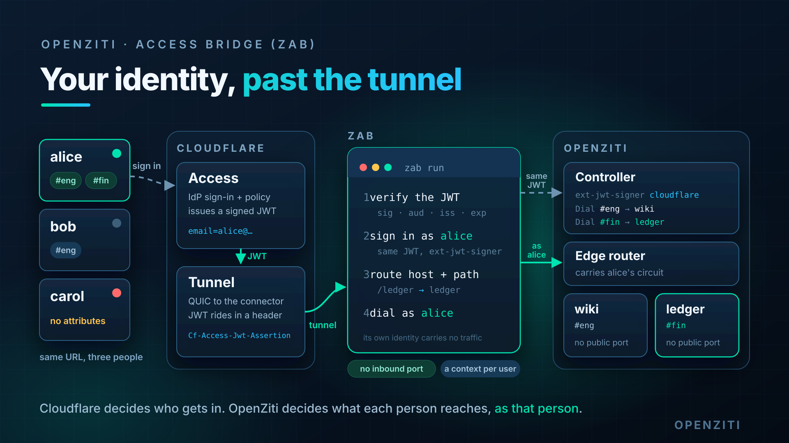
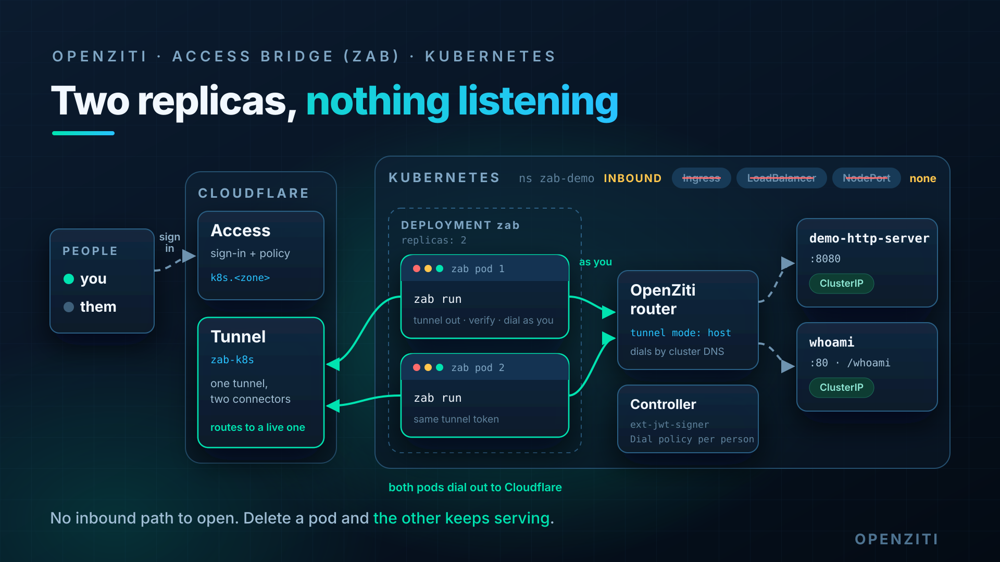

# Ziti TV, October 30, 2026: Your identity, past the tunnel

Cloudflare Access proves who you are at the front door. Once Cloudflare Tunnel hands the request to the connector,
that identity is gone: every user arrives from the same connector, and the network behind it can only tell them
apart by IP and port. Ziti Access Bridge (ZAB) fixes the last hop. It runs the Cloudflare Tunnel itself, checks the
Access JWT on every request, and signs in to OpenZiti **as the person who sent it**, with that same JWT. OpenZiti
service policy then decides what each person reaches.



You end up with:

- One URL, `https://zab.<your zone>`, behind a Cloudflare Access application.
- Two apps on `127.0.0.1` with no open port: a **wiki** at `/` and a **ledger** at `/ledger`.
- Three people who all pass Cloudflare Access and get three different answers from OpenZiti:

| Person | OpenZiti attributes | `/` | `/ledger/` |
| --- | --- | --- | --- |
| alice | `eng`, `fin` | wiki | ledger |
| bob | `eng` | wiki | wiki: his route table has no ledger |
| carol | none | 403 | 403 |

- A live revoke: drop alice's `fin` attribute and her next request no longer reaches the ledger.
- The same bridge in Kubernetes, with no Ingress, no LoadBalancer and no NodePort.

This assumes you have used OpenZiti and know what a service policy and an external JWT signer are. You need:

- A Cloudflare account with a domain (a zone) on it, and Zero Trust enabled. The free plan covers this.
- Three email addresses you can read, one per person. Cloudflare's One-time PIN login sends each a code.
- One machine with Go 1.27, Python 3, `git` and `curl`. Nothing on it accepts inbound connections.
- For the Kubernetes part, a cluster you can reach with `kubectl` and an OpenZiti router running in it.

Commands tagged **[bash]** run in bash on that machine. They were tested in Git Bash on Windows 11, and are the same
on Linux and macOS. Commands tagged **[brave]** are a browser.

Versions: OpenZiti 2.0.3, ziti-access-bridge `8720108`.

## 1. ZAB is a proof of concept, so build it from source

**[bash]**

```bash
git clone https://github.com/openziti-test-kitchen/ziti-tv.git
cd ziti-tv/live-stream/2026/10-30
cp default.env .env      # edit it in section 3

git clone https://github.com/openziti-test-kitchen/ziti-access-bridge.git ../zab-src
git -C ../zab-src checkout 8720108
(cd ../zab-src && go build -o "$OLDPWD/bin/" ./cmd/zab ./demo/cmd/demo-http-server)
export PATH="$PWD/bin:$PATH"
zab --help
```

## 2. Cloudflare owns the URL and the login

Everything public lives in Cloudflare. The tunnel is outbound only: ZAB dials Cloudflare, so the machine opens no
port.

In the Cloudflare dashboard:

1. **Zero Trust, Networks, Tunnels:** create a tunnel of type Cloudflared named `zab-local`. Skip the connector
   install, and copy the token from the install command. It is the long string after `--token`.
2. **On that tunnel, Public Hostname:** add `zab.<your zone>` with service `http://localhost:8080`. ZAB handles the
   request itself and never uses the service value, but the form requires one.
3. **Zero Trust, Settings, Authentication:** make sure **One-time PIN** is a login method.
4. **Zero Trust, Access, Applications:** add a **Self-hosted** application on `zab.<your zone>`. Give it a policy
   with action Allow and an Include rule of **Emails** that lists alice's, bob's and carol's addresses.
5. Copy the application's **Application Audience (AUD) Tag**, and your team domain, `<team>.cloudflareaccess.com`,
   from Zero Trust settings.

All three people pass Cloudflare. Cloudflare decides who gets to the door. OpenZiti decides which rooms they enter.

## 3. Every machine-specific value goes in `.env`

**[bash]**

```bash
# ZAB_HOST, CF_TEAM_DOMAIN, CF_AUD from section 2. ALICE, BOB, CAROL: the three email addresses
${EDITOR:-nano} .env
set -a; source .env; set +a
mkdir -p zab
# the tunnel token from section 2. setup.sh and reset.sh never touch this file
printf '%s' '<paste the tunnel token>' > zab/tunnel.token
```

## 4. The router hosts the apps, so no tunneler is needed

The quickstart runs a controller and a router in one process. The router also hosts services: it reaches the two
apps on `127.0.0.1` itself.

**[bash]**

```bash
# Linux amd64. Other platforms: https://github.com/openziti/ziti/releases/tag/v2.0.3
rel="https://github.com/openziti/ziti/releases/download/v$OPENZITI_VERSION"
curl -fsSL "$rel/ziti-linux-amd64-$OPENZITI_VERSION.tar.gz" \
  | tar -xz -C bin ziti
# leave it running, and open a second shell for the rest
ziti edge quickstart --home ./qs
```

In the second shell, `cd` back to this directory, run `export PATH="$PWD/bin:$PATH"`, and source `.env` again.

## 5. OpenZiti has to know the three people by their email

[setup.sh](setup.sh) does the OpenZiti side, and is safe to rerun. Read it before you run it. It:

- creates ZAB's own identity, enrolls it, and registers the `zab-v1.0.0` config type. ZAB's identity finds the
  controllers and manages configs. It never carries a request.
- creates an external JWT signer for your Cloudflare team. OpenZiti fetches Cloudflare's signing keys itself, and
  matches the JWT's `email` claim to an identity's **external id**.
- creates alice (`eng`, `fin`), bob (`eng`) and carol (no attributes), each with their email as external id.
- creates the `wiki` and `ledger` services. Each gets a `zab-v1.0.0` config, which says which hostname and path ZAB
  routes to it, and a `host.v1` config, which says where the router sends the traffic.
- lets only the router **Bind** the services, `#eng` **Dial** the wiki, and `#fin` **Dial** the ledger.

**[bash]**

```bash
bash setup.sh
```

The last lines come from the policy advisor: alice can dial both services.

## 6. The apps listen on loopback only

The wiki is ZAB's demo server. It verifies the Cloudflare JWT a second time and shows it. The ledger is a static
page. Both listen on `127.0.0.1`, so from outside the machine the only way in is through the OpenZiti router.

**[bash]**

```bash
demo-http-server --port "$WIKI_PORT" --cloudflare-team-domain "$CF_TEAM_DOMAIN" --cloudflare-aud "$CF_AUD" &
python3 -m http.server "$LEDGER_PORT" --bind 127.0.0.1 --directory ledger &
# nothing reaches the wiki without a Cloudflare JWT: this prints 401
curl -s -o /dev/null -w '%{http_code}\n' "http://127.0.0.1:$WIKI_PORT/"
```

## 7. One process terminates the tunnel and bridges to OpenZiti

**[bash]**

```bash
zab --config zab/config.yml run
```

In another shell:

**[bash]**

```bash
zab --config zab/config.yml agent status
zab --config zab/config.yml agent service list
```

`status` shows the controller live, the running ZAB, and `zab-v1.0.0 - supported`. `service list` shows `wiki` on
`zab.<your zone>/` and `ledger` on `zab.<your zone>/ledger`, with `strips path prefix`.

## 8. Same URL, three people, three answers

Use a separate private window per person, so each gets their own Cloudflare session.

**[brave]**

```text
https://zab.<your zone>/           as alice: the wiki greets alice and shows the verified JWT
https://zab.<your zone>/ledger/    as alice: the ledger
https://zab.<your zone>/ledger/    as bob: the wiki
https://zab.<your zone>/           as carol: 403, no route for requester
```

bob gets the wiki at `/ledger/` because OpenZiti never shows him the `ledger` service. ZAB builds each person's route
table from the services that person can see, so bob's table has no `/ledger` entry, and `/` matches instead.

Try a fourth address that is not in the Access policy. Cloudflare stops it at the login page, and ZAB never sees it.

Every answer was decided by OpenZiti service policy, evaluated for the person, not for the tunnel. ZAB dials each
service with that person's own OpenZiti session.

## 9. Taking access away works mid-session

**[bash]**

```bash
ziti edge update identity "$ALICE" --role-attributes eng
```

Reload `/ledger/` as alice. Within about a second she gets the wiki: OpenZiti refuses her next dial to `ledger`, and
the route is gone. Nothing changed in Cloudflare, and Cloudflare still lets her in.

Give it back:

**[bash]**

```bash
ziti edge update identity "$ALICE" --role-attributes eng,fin
```

Granting is slower than revoking. ZAB learns about a new service when the OpenZiti SDK refreshes alice's service
list, which it does every five minutes.

## 10. The same bridge in Kubernetes needs no inbound path

The [k8s](k8s/) directory runs ZAB as a two-replica Deployment next to two ClusterIP apps. There is no Ingress, no
LoadBalancer and no NodePort. Both ZAB pods dial out to the same Cloudflare tunnel, and an OpenZiti router in the
cluster, in tunnel mode `host`, reaches the apps by cluster DNS.



Create a second tunnel, `zab-k8s`, with public hostname `k8s.<your zone>`, and a second Access application on that
hostname. Then follow [k8s/k8s-status.md](k8s/k8s-status.md): it builds the images, creates the Secrets from ZAB's
enrollment files and the tunnel token, and applies the manifests.

**[bash]**

```bash
kubectl -n zab-demo get svc,ingress          # two ClusterIP services, no ingress
kubectl -n zab-demo get pods -l app=zab      # two replicas on one tunnel
# remove one replica while a browser keeps reloading. Cloudflare routes to the other
kubectl -n zab-demo delete pod "$(kubectl -n zab-demo get pod -l app=zab -o name | head -1 | cut -d/ -f2)"
```

## 11. What this does not do

- **It does not replace Cloudflare Access.** A request without a valid Access JWT for your AUD tag gets a 401 from
  ZAB. Cloudflare still owns the login and the first policy.
- **It does not provision people.** alice, bob and carol exist because `setup.sh` made them. OpenZiti 2.0 can create
  identities on first sign-in through an external JWT signer. This episode does not use that.
- **It does not protect the apps from their own machine.** Anything running on the router's machine reaches
  `127.0.0.1`. Put the apps where only the hosting router can reach them.
- **It is a test kitchen proof of concept,** pinned to one commit. Do not run it in production as is.

## 12. Run it again

[reset.sh](reset.sh) deletes everything `setup.sh` made on the controller, and ZAB's files in `zab/` except the
tunnel token. Stop `zab run` first.

**[bash]**

```bash
bash reset.sh
bash setup.sh
```

To tear it all down: run `reset.sh`, stop the quickstart and the two apps, and delete `qs/`. In Cloudflare, delete
the `zab-local` tunnel and the Access application.

## Troubleshooting

**People who should get 403 get a 502, `openziti service unreachable`.**
The Bind policy names `#all`. Every identity can then see every service, so ZAB routes the request, and the dial
fails. Bind only the router, `--identity-roles '@router-instance-1'`, as `setup.sh` does. The ZAB README uses `#all`
for both policies, which is fine for one user and wrong for several.

**Everyone gets 403, `requester is not known to openziti`.**
OpenZiti rejected the JWT. Any of these causes it:

- The signer's issuer is not exactly `https://<team>.cloudflareaccess.com`.
- `CF_AUD` is not the application's AUD tag.
- The auth policy does not list the signer's id.
- The person's identity has no external id equal to their email.

`ziti edge list ext-jwt-signers` and `ziti edge list auth-policies` show the first three.

**`setup.sh` stops with `name must be unique` or `issuer must be unique` on the signer.**
OpenZiti will not delete a signer the auth policy still names, so the old one is still there. `setup.sh` releases it
first: `ziti edge update auth-policy default --primary-ext-jwt-allowed-signers ''`. `issuer must be unique` means
another signer already uses your team domain. Delete it, or reuse it.

**`zab enroll` fails because the token expired.**
Rerun `bash setup.sh`. It deletes the `zab` identity and makes a new one.

**A service is missing from `agent service list`, or ZAB routes it with no `host.v1`.**
`ziti edge update service --configs` replaces the whole list. Name both configs: `wiki.zab-v1.0.0,wiki.host`.

**A re-granted person still cannot reach the service.**
Wait up to five minutes for the SDK's service refresh, or restart `zab run`.
